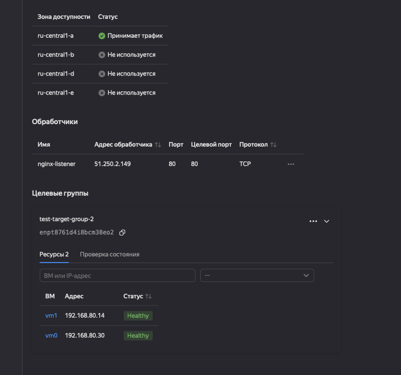
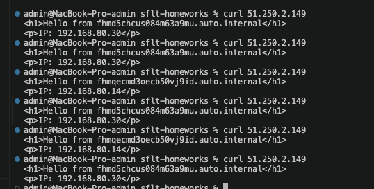

# Домашние задания по модулю  «Отказоустойчивость» Д.А. Заяц

В этом репозитории расположены ваши домашние задания к каждой лекции. 

Обязательны к выполнению задачи без звездочек. Их нужно выполнить, чтобы получить зачёт.

Задачи со звёздочкой (*) — дополнительные задачи или задачи повышенной сложности. Их выполнять не обязательно, но они помогут вам глубже понять тему.

Любые вопросы по решению задач задавайте в чате учебной группы. Ссылку вы найдёте в письме на вашей электронной почте.

1. 

2. 
